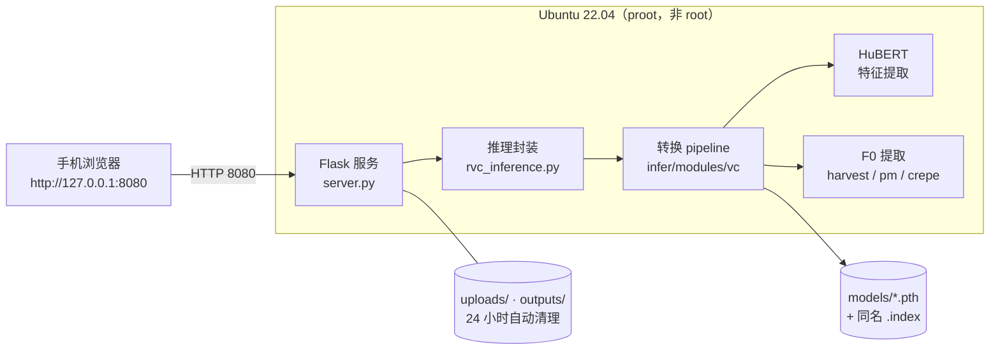

# RVC Android 翻唱工具

> 在 Android 手机上离线跑 [RVC](https://github.com/RVC-Project/Retrieval-based-Voice-Conversion-WebUI)（Retrieval-based Voice Conversion）翻唱：Termux + proot-distro 装一个 Ubuntu，CPU 推理，浏览器上传音频即可换声。

[](https://github.com/fdhxk/RVC-by-Android/releases/latest)
[](LICENSE)
[]()
[]()

- **纯离线**：不联云端、不上传音频到第三方
- **不需要 root**：靠 proot 在用户态跑完整 Ubuntu
- **不需要 GPU**：CPU 推理，适配手机
- **开箱即用**：[Release](https://github.com/fdhxk/RVC-by-Android/releases/latest) 提供 Termux 安装包 + 已装好环境的备份包，一键恢复
- **Web 界面**：手机自带浏览器操作，支持上传模型、上传音频、变调、音高提取方法等参数

> ⚠️ 仅供个人学习与自娱自乐。请勿用于冒充他人、诈骗或未经授权的商业用途，详见[声明](#声明)。

---

## 目录

- [整体架构](#整体架构)
- [一、普通用户：一键恢复（推荐）](#一普通用户一键恢复推荐)
- [二、开发者：从源码安装](#二开发者从源码安装)
- [仓库结构](#仓库结构)
- [模型文件](#模型文件)
- [Web 界面使用说明](#web-界面使用说明)
- [分发给其他人](#分发给其他人)
- [常见问题](#常见问题)
- [性能与限制](#性能与限制)
- [技术栈](#技术栈)
- [声明](#声明)
- [第三方代码与许可](#第三方代码与许可)

---

## 整体架构



运行时，代码被复制进 Ubuntu 容器的 `/root/rvc-app`，由容器内的 `python3.10` 执行；Termux 只负责提供 proot 环境和启动入口。

---

## 一、普通用户：一键恢复（推荐）

**不需要懂 Linux，也不需要装依赖**，全部环境都在备份包里。

### 前提

| 项目 | 要求 |
|------|------|
| 设备 | ARM64（arm64-v8a）Android 手机 |
| 系统 | Android 7.0 及以上 |
| 空闲存储 | **≥ 5 GB**（备份包 1.82 GB + 解压后环境约 3 GB） |
| 网络 | 下载备份包用 WiFi，之后可完全离线 |

### 步骤

1. 打开 [Release v1.0.0](https://github.com/fdhxk/RVC-by-Android/releases/latest)，下载这 3 个文件：
   - `Termux.apk`（33.5 MB）
   - `rvc-termux-backup-2026.tar.gz`（1.82 GB）
   - `restore.sh`（4 KB）
2. 把 `rvc-termux-backup-2026.tar.gz` 和 `restore.sh` 放进手机 **【下载 / Download】** 文件夹（**不要解压**）。
3. 安装 `Termux.apk`（系统提示"未知来源"时选择允许），打开一次 Termux，等它初始化完成（出现绿色提示符号后按回车）。
4. 授权存储访问，弹出系统弹窗时点【允许】：

   ```bash
   termux-setup-storage
   ```

5. 运行恢复脚本，然后等几分钟（屏幕保持常亮、不要关窗口）：

   ```bash
   bash /sdcard/Download/restore.sh
   ```

6. 脚本会自动解压环境、校验完整性，并把"打开 Termux 即自动启动服务"写进 `~/.bashrc`。完成后输入 `exit` 关闭，再重新打开 Termux，等 10~30 秒首次加载模型。
7. 用手机浏览器打开 **http://127.0.0.1:8080** 即可使用。

> 同一 WiFi 下的电脑 / 平板也能用：浏览器打开 `http://<手机局域网 IP>:8080`，IP 会在 Termux 启动时打印出来。

---

## 二、开发者：从源码安装

适合想改代码、换模型、自己打包分发的场景。

### 1. 准备 Termux 与目录

```bash
# 安装 Termux 后先授权存储
termux-setup-storage

# 代码必须放在 ~/rvc-app（脚本里写死了这个路径）
git clone https://github.com/fdhxk/RVC-by-Android.git ~/rvc-app
```

### 2. 放好模型文件

按[模型文件](#模型文件)一节的表格，把 `hubert_base.pt` 等放进对应目录。`models/` 里已带一个示例音色 `kikiV1.pth`，可直接试跑。

### 3. 一键安装环境

```bash
bash ~/rvc-app/install.sh
```

脚本做的事（约下载 1.5 GB，10~30 分钟）：

| 阶段 | 内容 |
|------|------|
| 1 | `pkg update`，安装 `proot-distro` |
| 2 | 安装 Ubuntu 22.04 rootfs（约 500 MB；优先用手机 Download 里的本地镜像，没有才在线下载） |
| 3 | 把 `~/rvc-app` 整个复制进容器 `/root/rvc-app` |
| 4 | 容器内换华为云软件源，`apt` 装 `python3.10 / pip / ffmpeg / libsndfile1 / build-essential` |
| 5 | 固定 `pip==24.0`，按 `requirements.txt` 装依赖（含 CPU 版 PyTorch 2.3.1） |

> 安装中断可以直接重跑，脚本会跳过已完成的步骤。
>
> **国内网络提示**：脚本已针对 pip / apt 使用镜像加速；只有 Ubuntu 镜像本身可能连不上 Docker Hub —— 此时在电脑上下载
> `https://cloud-images.ubuntu.com/releases/jammy/release-20260320/ubuntu-22.04-server-cloudimg-arm64-root.tar.xz`，
> 放进手机 Download 目录后重跑 `install.sh`，脚本会自动识别并本地导入。

### 4. 启动

```bash
bash ~/rvc-app/start.sh          # 默认 8080 端口
bash ~/rvc-app/start.sh 8081     # 指定其他端口
```

浏览器打开 `http://127.0.0.1:8080`（同一 WiFi 的其他设备用 `http://<手机IP>:8080`）。

### 5. 改代码之后

容器里的代码是**复制**进去的，不是挂载。改完 `~/rvc-app` 里的文件后必须重跑一次：

```bash
bash ~/rvc-app/install.sh
```

它会重新同步代码（并清空容器内的 `uploads/`、`outputs/`）。

---

## 仓库结构

代码平铺在仓库根目录，克隆后即是可运行目录（`~/rvc-app`）：

```
.
├── server.py                 # Flask Web 服务：页面 + /api/models /api/convert /api/download 等接口
├── rvc_inference.py          # RVC 推理封装：加载 .pth、自动关联 .index、调用 pipeline
├── infer/                    # RVC 推理核心（上游代码精简，仅保留推理）
│   ├── lib/                  # 网络结构、HuBERT / RMVPE 加载、音频读取、F0 预测器
│   └── modules/vc/           # 转换 pipeline 与工具函数
├── assets/
│   ├── hubert/.gitignore     # hubert_base.pt 放这里（大文件不入库）
│   └── rmvpe/.gitignore      # rmvpe.pt 放这里（大文件不入库）
├── models/
│   └── kikiV1.pth            # 示例音色模型（52 MB，已入库）
├── templates/index.html      # Web 界面
├── static/css|js/            # 前端资源
├── requirements.txt          # Python 依赖（固定版本）
├── install.sh                # 一键安装（Termux → proot Ubuntu → 依赖）
├── start.sh                  # 手动启动服务
├── backup.sh                 # 把装好的环境打包成可分发备份包
├── restore.sh                # 在目标手机一键恢复 + 配置自启动
├── LICENSE                   # GPL-3.0
└── THIRD_PARTY_NOTICES.md    # 第三方代码与模型声明
```

`assets/hubert/` 与 `assets/rmvpe/` 里的 `.gitignore` 内容为 `*` + `!.gitignore`，因此两个大权重不会被仓库收录。

---

## 模型文件

| 文件 | 体积 | 必需性 | 放置位置 | 说明 |
|------|------|--------|----------|------|
| `hubert_base.pt` | 180.7 MiB（189,507,909 B） | **必需** | `assets/hubert/` | HuBERT 特征提取；缺失时转换会报 `HuBERT模型不存在` |
| `rmvpe.pt` | 172.8 MiB（181,184,272 B） | 可选 | `assets/rmvpe/` | RMVPE 音高提取；pipeline 已支持 `rmvpe` 方法，当前 Web 界面开放的是 harvest / pm / crepe |
| `*.pth` | 通常 50~200 MB | 按需 | `models/` | RVC 音色模型，v1 / v2 均支持 |
| `*.index` | 几 MB~几十 MB | 可选 | `models/` | FAISS 检索索引；与模型**同名**（如 `kikiV1.index`）时自动启用 |

获取方式：

- **最快**：直接从 [Release v1.0.0](https://github.com/fdhxk/RVC-by-Android/releases/latest) 下载 `hubert_base.pt` 和 `rmvpe.pt`
- HuBERT 原始地址：`https://dl.fbaipublicfiles.com/hubert/hubert_base.pt`（fairseq 官方）
- 音色模型：用 RVC 训练出的 `.pth`（例：仓库自带的 `models/kikiV1.pth`），也可以启动后通过网页直接上传

> 注意：只有装到**源码目录** `~/rvc-app` 才会在下次 `install.sh` 时同步进容器；如果环境已经装好、只是临时加模型，更省事的办法是**打开网页用"上传新模型"**——文件会落在容器内 `models/` 并立即可选。

---

## Web 界面使用说明

1. **选择模型**：下拉框列出 `models/` 下所有 `.pth`（点右侧 ⟳ 刷新）；也可拖拽上传新的 `.pth`（≤ 1 GB）。
2. **上传音频**：支持 `wav` / `mp3` / `flac` / `ogg` / `m4a` / `aac`，单文件上限 1 GB。
3. **调参**（见下表），点"开始转换"。
4. **下载结果**：输出统一为 **WAV**，采样率跟随模型（`kikiV1` 等 v2 模型通常 40k/48k）。

| 参数 | 范围 | 默认 | 作用与建议 |
|------|------|------|------------|
| 变调（key） | -12 ~ +12 半音 | 0 | 男声→女声常用 +12，女声→男声常用 -12；同一性别微调 ±2~±4 更自然 |
| 音高提取（method） | `harvest` / `pm` / `crepe` | `harvest` | `harvest` 最稳（推荐），`pm` 最快、质量一般，`crepe` 质量好但更慢 |
| 索引匹配率（index_rate） | 0 ~ 1 | 0.66 | 越接近 1 越像目标音色，过高会吞掉咬字细节；一般 0.5~0.8 |
| 滤波半径（filter_radius） | 0 ~ 7 | 3 | 对 F0 做中值滤波，抑制破音/沙哑；杂音多时加到 5~7 |
| RMS 混合率（rms_mix_rate） | 0 ~ 1 | 1.0 | 1.0 跟随原音频响度起伏，调小更接近模型原始响度 |
| 保护参数（protect） | 0 ~ 0.5 | 0.33 | 保护清辅音与气声，防止"电音感"；过大会保留原音色；与 `filter_radius` 不宜同时调高 |

> 上传的音频与输出文件会在 **24 小时**后自动清理（每次服务启动时清理一次过期文件）。转换中途别刷新页面，等待即可。

---

## 分发给其他人

1. 在**已装好环境**的手机上打包（默认完整模式，含 hubert / rmvpe，但**不含** `models/*.pth`）：

   ```bash
   bash ~/rvc-app/backup.sh          # 完整包，约 1.8~2 GB，客户恢复后即可用
   bash ~/rvc-app/backup.sh 精简     # 精简包，不含 hubert/rmvpe，体积小
   ```

   产物落在手机 `Download/rvc-termux-backup-<日期>.tar.gz`，打包耗时 10~30 分钟，请保持屏幕常亮。

2. 把「备份包 + `restore.sh` + `Termux.apk`」发给对方，让对方按[一键恢复](#一普通用户一键恢复推荐)操作即可。

[Release v1.0.0](https://github.com/fdhxk/RVC-by-Android/releases/latest) 的资产就是一套现成的分发材料：

| 资产 | 大小 | 用途 |
|------|------|------|
| `Termux.apk` | 33.5 MB | 配套 Termux 安装包（用这个，别用应用商店版本） |
| `rvc-termux-backup-2026.tar.gz` | 1.82 GB | 已装好 Ubuntu + 依赖 + 模型的环境 |
| `restore.sh` | 4 KB | 恢复向导 |
| `hubert_base.pt` / `rmvpe.pt` | 180.7 / 172.8 MiB | 单独下载权重 |
| `step.txt` | 410 B | 操作步骤速查 |

---

## 常见问题

<details>
<summary><b>Ubuntu 镜像下载不动 / 超时</b></summary>

国内访问 Docker Hub 经常超时。在电脑上下载 `ubuntu-22.04-server-cloudimg-arm64-root.tar.xz`，放进手机 **Download** 目录，重跑 `install.sh`，脚本会自动本地导入。
</details>

<details>
<summary><b>pip 安装报 <code>No module named 'yaml'</code>、blinker、metadata 错误</b></summary>

`omegaconf 2.0.x` 的依赖声明 `PyYAML (>=5.1.*)` 不合规、新版 pip 会拒绝解析。脚本已固定 `pip==24.0`、显式安装 `PyYAML`、并对系统预装的 blinker 使用 `--ignore-installed`。手工装依赖时请照做。
</details>

<details>
<summary><b>转换报 <code>HuBERT模型不存在</code></b></summary>

`assets/hubert/hubert_base.pt` 没放对位置。按[模型文件](#模型文件)放好后重跑 `install.sh`，或直接用网页上传模型的方式部署。
</details>

<details>
<summary><b>模型下拉框里看不到我放的 .pth</b></summary>

点下拉框右侧的 ⟳ 刷新；确认文件名以 `.pth` 结尾、不含空格和特殊字符。若环境已装好，放进源码目录 `models/` 后需要重跑 `install.sh` 才会同步进容器。
</details>

<details>
<summary><b>Termux 切后台就被杀 / 服务自己停了</b></summary>

在系统设置里给 Termux 关掉电池优化、允许后台运行；Termux 内执行 `termux-wake-lock`；使用过程中尽量保持 Termux 窗口不清理。
</details>

<details>
<summary><b>8080 端口被占用</b></summary>

换端口启动：`bash ~/rvc-app/start.sh 8081`，然后访问 `http://127.0.0.1:8081`。
</details>

<details>
<summary><b>电脑打不开手机上的页面</b></summary>

确认手机和电脑在同一 WiFi；用 `start.sh` 打印的局域网地址（形如 `http://192.168.x.x:8080`）；部分路由器开了 AP 隔离会导致互相访问不了。
</details>

<details>
<summary><b>存储空间不够</b></summary>

完整环境约 3 GB，加上备份包 1.82 GB，建议预留 5 GB 以上；用完可删掉 `Download` 里的备份包。
</details>

---

## 性能与限制

- **仅 CPU 推理**：`rvc_inference.py` 在无 CUDA / MPS 时自动回落 CPU，并使用低内存分段参数（`x_pad=1, x_query=6, x_center=38, x_max=41`）。手机端转换明显慢于电脑，**建议单段 1~2 分钟以内的音频**，长音频先用剪辑软件切段。
- **只做离线翻唱**：不含实时变声、不含训练、不含批量推理（这些是上游 RVC WebUI 的能力，本项目做了大幅裁剪）。
- **默认监听 `0.0.0.0` 且没有登录鉴权**：同一局域网内任何人打开 IP:8080 都能访问并上传文件。在公共 WiFi/公司网络下建议改成只监听本机：

  ```bash
  proot-distro login ubuntu -- bash -c "cd /root/rvc-app && python3 server.py --host 127.0.0.1 --port 8080"
  ```

- **输出只有 WAV**，不提供 mp3 转码；上传/输出文件 24 小时后自动清理。

---

## 技术栈

| 层 | 组件 |
|----|------|
| 运行环境 | Termux → `proot-distro` → Ubuntu 22.04 → Python 3.10 |
| 推理 | PyTorch 2.3.1 (CPU) / torchaudio 2.3.1 / fairseq 0.12.2 / faiss-cpu 1.7.3 |
| 音频 | librosa 0.9.1 / soundfile / av / praat-parselmouth / pyworld / torchcrepe |
| Web | Flask ≥2.3 + flask-cors ≥4.0，原生 HTML/CSS/JS 前端 |

完整版本约束见 [requirements.txt](requirements.txt)。

---

## 声明

本工具仅供学习研究使用。**请勿用于**：

- 冒充他人身份、伪造语音进行诈骗或误导
- 未经授权的商业用途，或侵犯他人声音权、肖像权等权益

使用本工具产生的一切后果由使用者自行承担。

---

## 第三方代码与许可

- `infer/` 目录基于 [RVC-Project/Retrieval-based-Voice-Conversion-WebUI](https://github.com/RVC-Project/Retrieval-based-Voice-Conversion-WebUI)（MIT，Copyright © 2023 liujing04）精简改造，保留原始许可声明，详见 [THIRD_PARTY_NOTICES.md](THIRD_PARTY_NOTICES.md)
- HuBERT、RMVPE 预训练权重版权归各自作者所有
- `models/` 下的音色模型版权归对应声源人及训练者所有，使用前请确认已获授权

本仓库整体以 [GPL-3.0](LICENSE) 发布。
